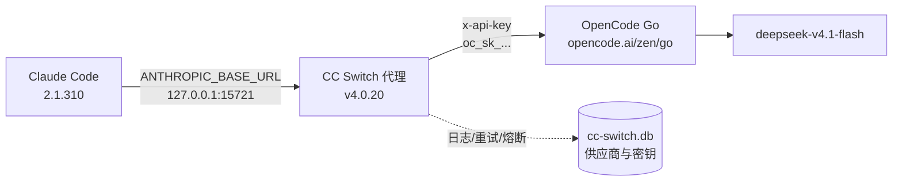

# CC Switch v4 与 OpenCode Go 接入 Claude Code

> 建立日期：2026-10-26
> 状态：已实施并验证（Claude Code 2.1.310 + CC Switch v4.0.20）
> 给后续 AI 对话的简报：`AI上下文.md`

---

## 1. 目标与结论

把 OpenCode Go 的 API 接进 Claude Code，并用 CC Switch 做供应商切换、配置备份与故障重试。

最终采用的是**代理接管**模式：

- CC Switch 在本机起一个代理，监听 `127.0.0.1:15721`。
- `~/.claude/settings.json` 只写 `ANTHROPIC_BASE_URL=http://127.0.0.1:15721` 和占位密钥 `ANTHROPIC_API_KEY=PROXY_MANAGED`。
- 真实密钥 `oc_sk_...` 保存在 CC Switch 的数据库里，请求由代理转发到 `https://opencode.ai/zen/go/v1/messages`。

这样做的原因：

1. 真实的 key 不落在 `settings.json` 里，切换供应商不用改文件。
2. 代理带重试、日志、成本统计和故障转移，比直连多一层可见性。
3. 后续加 Codex / Gemini CLI 时，可以复用同一份供应商配置。

验证方式：代理日志里能看到每一轮对话都指向 `zen/go`，且实际执行的模型是 `deepseek-v4.1-flash`。

---

## 2. 链路结构



关键点：**Claude Code 里看到的模型名不是实际上游模型名**。

| 层面 | 显示值 | 来源 |
|---|---|---|
| Claude Code 界面 | `claude-opus-5` 等 | `ANTHROPIC_DEFAULT_*_MODEL` |
| CC Switch 代理 | `deepseek-v4.1-flash` | `ANTHROPIC_DEFAULT_*_MODEL_NAME` |
| 实际上游 | `deepseek-v4.1-flash` | OpenCode Go 执行 |

判断是否真的走 OpenCode Go，**以代理日志为准**，不要以界面模型名为准。

---

## 3. 关键路径

| 项目 | 路径 |
|---|---|
| CC Switch 程序 | `C:\Users\15198\AppData\Local\Programs\CC Switch\cc-switch.exe`（v4.0.20） |
| CC Switch 数据目录 | `C:\Users\15198\.cc-switch\` |
| 供应商数据库 | `C:\Users\15198\.cc-switch\cc-switch.db` |
| 代理日志 | `C:\Users\15198\.cc-switch\logs\cc-switch.log` |
| Claude Code 配置 | `C:\Users\15198\.claude\settings.json` |
| 配置备份 | `C:\Users\15198\Downloads\cc-switch-backup-20261026\` |
| 安装包 | `C:\Users\15198\Downloads\CC-Switch-v4.0.20-Windows.msi` |

数据库里相关表：

- `providers`：`id`、`app_type`（`claude` / `codex` / `gemini`）、`name`、`settings_config`（JSON）、`meta`（JSON）、`is_current`。
- `proxy_config`：`proxy_enabled`、`listen_address`、`listen_port`、日志开关、重试次数、熔断阈值。

---

## 4. 当前配置

### 4.1 生效的供应商：OpenCode Go

```text
ANTHROPIC_BASE_URL                = https://opencode.ai/zen/go
ANTHROPIC_API_KEY                 = oc_sk_...（51 位，明文存在 cc-switch.db 里）
ANTHROPIC_MODEL                   = deepseek-v4.1-flash
ANTHROPIC_DEFAULT_OPUS_MODEL      = deepseek-v4.1-flash
ANTHROPIC_DEFAULT_SONNET_MODEL    = deepseek-v4.1-flash
ANTHROPIC_DEFAULT_FABLE_MODEL     = deepseek-v4.1-flash
ANTHROPIC_DEFAULT_HAIKU_MODEL     = claude-haiku-5-5
CLAUDE_CODE_DISABLE_EXPERIMENTAL_BETAS = 1
```

`meta`：

```json
{"commonConfigEnabled": false, "endpointAutoSelect": true,
 "apiFormat": "anthropic", "apiKeyField": "ANTHROPIC_API_KEY"}
```

其中 `apiFormat` 必须是 `anthropic`。OpenCode Go 走的是 Anthropic Messages 协议，选成 `openai_chat` 会转发失败。

### 4.2 Claude Code 的 settings.json（代理模式）

```json
{
  "env": {
    "ANTHROPIC_API_KEY": "PROXY_MANAGED",
    "ANTHROPIC_BASE_URL": "http://127.0.0.1:15721",
    "ANTHROPIC_DEFAULT_OPUS_MODEL": "claude-opus-5",
    "ANTHROPIC_DEFAULT_SONNET_MODEL": "claude-sonnet-5",
    "ANTHROPIC_DEFAULT_HAIKU_MODEL": "claude-haiku-5-5",
    "ANTHROPIC_DEFAULT_FABLE_MODEL": "claude-fable-5",
    "ANTHROPIC_DEFAULT_OPUS_MODEL_NAME": "deepseek-v4.1-flash",
    "ANTHROPIC_DEFAULT_SONNET_MODEL_NAME": "deepseek-v4.1-flash",
    "ANTHROPIC_DEFAULT_HAIKU_MODEL_NAME": "claude-haiku-5-5",
    "ANTHROPIC_DEFAULT_FABLE_MODEL_NAME": "deepseek-v4.1-flash",
    "CLAUDE_CODE_DISABLE_EXPERIMENTAL_BETAS": "1"
  },
  "model": "opus",
  "effortLevel": "high",
  "includeCoAuthoredBy": false
}
```

`PROXY_MANAGED` 是占位符，不是真实密钥，**不要**把它换成真 key——真 key 由 CC Switch 注入。

### 4.3 代理设置

| 项 | 值 |
|---|---|
| 监听 | `127.0.0.1:15721` |
| 启用 | 是 |
| 日志 | 开 |
| 自动故障转移 | 关 |
| 最大重试 | 6 |
| 首字节超时 | 90 秒 |
| 空闲超时 | 180 秒 |
| 非流式超时 | 600 秒 |

---

## 5. 日常使用

### 5.1 切换供应商

1. 打开 CC Switch，在 Claude 标签页点目标供应商卡片（如 DeepSeek）。
2. **完整退出 Claude Code 再启动**——环境变量只在进程启动时读取：

```bash
claude --continue
```

3. 进会话后跑 `/status`，确认 `ANTHROPIC_BASE_URL` 是 `127.0.0.1:15721`。

### 5.2 验证真的在走 OpenCode Go

```bash
tail -5 "C:\Users\15198\.cc-switch\logs\cc-switch.log"
```

正常会看到：

```text
[Claude] >>> 请求目标: https://opencode.ai/zen/go/v1/messages (model=deepseek-v4.1-flash)
```

如果这一行不出现，说明请求没走 OpenCode Go。

其他检查：

```bash
# 代理在不在监听
netstat -ano | grep 15721

# 当前供应商和 API 格式（只读）
sqlite3 -header -column "C:\Users\15198\.cc-switch\cc-switch.db" \
  "select name,is_current,json_extract(meta,'\$.apiFormat') from providers where app_type='claude';"
```

### 5.3 账单

消耗记在 OpenCode Go 账户上，国内 DeepSeek 账户不参与。

---

## 6. 新版 v4 的同步能力

v4.0.20 相对 3.16.4 的主要变化，值得记住的有四块：

### 6.1 统一供应商

同一份供应商配置可以同时供给 Claude Code、Codex、Gemini CLI。三端共用一套 base URL 和密钥，改一处三端生效。适合「一把 key 多客户端」的场景。

### 6.2 云端备份与 WebDAV 同步

CC Switch 内置 WebDAV 客户端（含坚果云预设），也有 S3 兼容存储。开启后供应商列表、MCP、Skills 会一起同步，换机器直接恢复，不必重配。

只在一台机器上用的话，这一项可以先不配。

### 6.3 MCP / Skills 复用

MCP server 和 Skills 可以跨客户端复用，不必每个客户端手写一遍配置。

### 6.4 代理接管

v4 新增把 Claude Code 的请求接管到本地代理的能力，附带重试、超时、熔断和成本统计。副作用是 **Claude Code 从此依赖 CC Switch 进程**：

- CC Switch 退出 → `15721` 没有监听 → Claude Code 连不上。
- 想摆脱依赖，可在代理设置里关闭接管，配置会退回直连。直连时 `settings.json` 需要 `ANTHROPIC_BASE_URL=https://opencode.ai/zen/go` + 真实 `ANTHROPIC_API_KEY`。

---

## 7. 回滚

按代价从小到大：

### 7.1 切回另一个供应商（最轻）

CC Switch 里点 DeepSeek 卡片 → 重启 Claude Code。

注意：DeepSeek 那条供应商的模型名是 `deepseek-v4-flash[1M]`。带 `[1M]` 后缀的模型名在 OpenCode Go 上会被拒绝（400 Model is unavailable），如果切回后报错，把 `ANTHROPIC_DEFAULT_*_MODEL` 改成不带后缀的 `deepseek-v4-flash`。

### 7.2 恢复 Claude Code 配置

```bash
copy "C:\Users\15198\.claude\settings.json.before-opencode-go.bak" ^
     "C:\Users\15198\.claude\settings.json"
```

这份是切到 OpenCode Go 之前的版本。恢复后重启 Claude Code。

### 7.3 恢复 CC Switch 数据库

```bash
# 先关掉 CC Switch，避免写冲突
copy "C:\Users\15198\Downloads\cc-switch-backup-20261026\cc-switch-post-v4.0.20.db" ^
     "C:\Users\15198\.cc-switch\cc-switch.db"
```

备份目录里的三个 DB：

| 文件 | 说明 |
|---|---|
| `cc-switch.db` | v3.16.4 升级前的原始库 |
| `cc-switch-post-v4.0.20.db` | 升级到 v4.0.20、**尚未**配置 OpenCode Go 时的库 |
| `claude-settings-before-opencode-go.json` | 同上时间点的 `settings.json` |

回退到 v3 需要同时卸载 v4 并装回旧版安装包，一般不必。

---

## 8. 排错

| 现象 | 原因 | 处理 |
|---|---|---|
| `Connection refused 127.0.0.1:15721` | CC Switch 没开或代理没启用 | 打开 CC Switch，或在代理设置里启用 |
| 401 / 403 | 密钥错，或 `apiFormat` 不是 `anthropic` | 检查供应商的 key 与 `meta.apiFormat` |
| 400 `MissingSessionID` | 客户端没带 `x-opencode-session` 头 | Claude Code 原生会带；用 curl 手测时需自己加 |
| 400 `Model is unavailable` | 模型名不可用，常见于带 `[1M]` 后缀 | 改成 `deepseek-v4.1-flash` |
| Bearer 认证无效 | `/zen/go` 只认 `x-api-key` | 用 `ANTHROPIC_API_KEY` 而不是 `ANTHROPIC_AUTH_TOKEN` |
| 界面显示 claude-opus-5 但在跑 DeepSeek | 代理的模型映射 | 正常，看代理日志确认 |
| 改完 settings.json 又被改回去 | CC Switch 正在运行，会重写该文件 | 先退出 CC Switch 再手改，或干脆只在 CC Switch 里改 |

备用直连写法（关闭代理接管时用）：

```text
ANTHROPIC_BASE_URL=https://opencode.ai/inference/go/anthropic
ANTHROPIC_AUTH_TOKEN=oc_sk_...
```

这是官方文档里的另一种入口，认证方式与 `/zen/go` 不同，二选一即可，不要混用。

---

## 9. 安全与已知限制

1. **密钥明文存在 `cc-switch.db`。** 这是 SQLite 文件，没有加密。不要把该文件或备份目录放进网盘公开分享。
2. **`settings.json` 里没有真实密钥**，只有 `PROXY_MANAGED`。这是代理模式的优点，不要手动填真 key。
3. **代理模式依赖 CC Switch 常驻。** 关掉它 Claude Code 就断，这是用「透明转发 + 日志 + 重试」换来的代价。
4. **不要让两个程序同时改 `settings.json`。** CC Switch 运行时会在切换供应商时重写该文件。
5. **升级会迁移数据库**（v3.16.4 → v4.0.20 时 `user_version` 变为 23）。升级前先备份数据库。
6. 代理只监听 `127.0.0.1`，不对局域网开放；不要改成 `0.0.0.0`。

---

## 10. 变更记录

| 日期 | 内容 |
|---|---|
| 2026-10-26 | 从 v3.16.4 升级到 v4.0.20；配置 OpenCode Go（`/zen/go` + `x-api-key` + `deepseek-v4.1-flash`）；启用代理接管（15721）；验证请求经代理到达 OpenCode Go；建立数据库与 settings 备份 |
